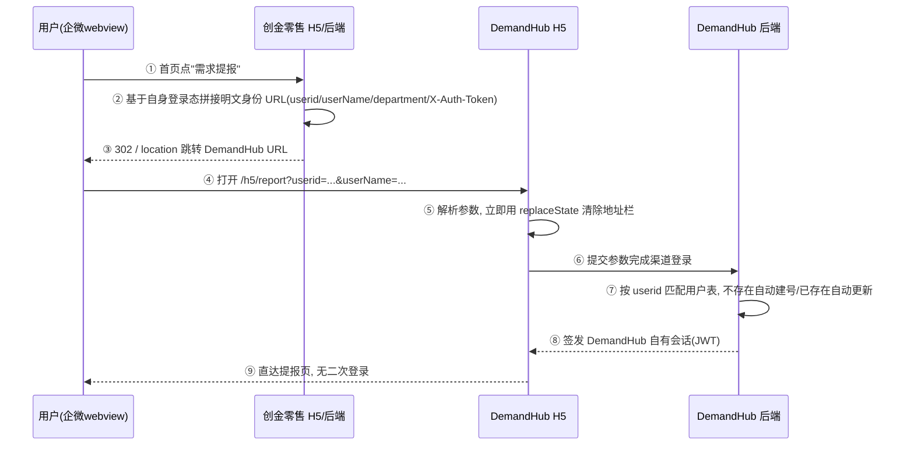

# DemandHub H5 嵌入 "创金零售" 企微应用・技术方案与对接标准 v2.0


| 项目   | 内容                                                                  |
| ---- | ------------------------------------------------------------------- |
| 文档名称 | DemandHub H5 嵌入创金零售技术方案与对接标准                                        |
| 版本   | v3.0（2026-10-16 双方协商：放弃 ticket 回源校验，改为 URL 明文身份直登；ticket 模式保留为备用方案，见附录 A） |
| 提出方  | 财管科技产品部（DemandHub 团队）                                               |
| 接收方  | 创金零售系统团队                                                            |
| 日期   | 2026-10-16                                                          |
| 对接方式 | 企微 webview 内路由跳转（非 iframe）+ URL 明文身份直登（无服务端回源校验）               |


***

## 1. 对接目标

在 "创金零售" 企微应用首页功能区新增 "需求提报" 入口，用户点击后在企微内置浏览器中打开 DemandHub H5 提报页，**沿用创金零售已有的企微登录态，无需二次登录**，实现零售一线手机端一键提报需求。

### 1.1 为什么不用 iframe

企微 webview 对 iframe 的登录态共享、JS 能力、高度自适应支持不稳定，一期采用路由跳转，体验为 "从创金零售跳到 DemandHub 提报页"，左上角一键返回。

### 1.2 为什么不共享企微应用 secret（重要）

v1.0 曾设想 DemandHub 注册独立应用或借用创金零售应用 secret 自行调企微 OAuth，评估后放弃：


* 创金零售是已投产系统，其应用 secret 跨系统共享违反密钥最小暴露原则，重置 / 泄露会互相影响生产；

* 同一 secret 双方分别刷新 access_token 会互相踢失效；

* 创金零售团队需要改生产应用可信域名等配置，迭代受制于人。

方案演进：v2.x 曾采用 "创金零售签发一次性票据、DemandHub 回源校验" 的渠道 SSO 模式；v3.0 经双方协商进一步简化为 **URL 明文身份直登**——创金零售确认其入口门禁自足（入口仅对企微内授权用户可见），DemandHub 不做任何身份校验、默认合法，对创金零售的增量仅剩 **一个入口跳转**。

### 1.3 创金零售侧不需要担心的事


* 不需要把应用 secret 交给 DemandHub；

* 不需要改可信域名、不需要在企微后台为 DemandHub 做任何配置；

* 不需要做前端组件合并、不改用户体系；

* 不需要把用户密码等任何凭证交给 DemandHub；

* 不需要为 DemandHub 提供任何服务端接口（v2.x 的票据校验接口自 v3.0 起不再需要）。

## 2. 整体流程




**信任链（安全前提与风险声明，双方协商的知情前提）**：身份以 URL 明文参数为准，DemandHub **不回源校验、不验证真伪**。URL 即身份——任何人持有完整 URL 即可以对应身份登录。安全性依赖三点：① 创金零售入口仅对企微内授权用户可见、链接不外泄；② 全程 HTTPS；③ DemandHub 进入页面即时清除地址栏参数（防截图泄露、防刷新重放、防转发带身份）。DemandHub 对 X-Auth-Token 不验真伪、不做服务端回源校验，系双方协商确认的有意决策。

## 3. 对接标准（创金零售侧需实现）

### 3.1 入口与跳转


* 位置：创金零售首页功能区宫格，"需求提报" 卡片（建议前 4 个高频入口之一，NEW 角标）。

* 点击行为：**由创金零售基于自身登录态实时拼接下述 URL 并跳转**（不要用写死参数的前端静态链接，身份参数必须实时取值）：

```
https://{demandhub-h5域名}/h5/report?userid={企微ID}&X-Auth-Token={宿主token}&userName={姓名}&department={部门}
```

真实示例（测试环境）：

```
https://fenhangtest.clearmindz.top/h5/demand-hub/?userid=xuwei&X-Auth-Token=3b73d6e04b654ca1b6eb30a8ea75635c&userName=许炜&department=银行
```

| 参数 | 必填 | 说明 |
| ------ | -- | ------------------------------------ |
| userid | 是 | 企业微信 userid（企业内永久不变），作为 DemandHub 匹配/建号主键；≤64 字符 |
| userName | 是 | 用户姓名，自动建号/更新用；≤64 字符 |
| department | 选填 | 组织/部门名称；≤128 字符；缺失不阻塞登录提报 |
| X-Auth-Token | 是 | 创金零售宿主会话凭证。**DemandHub 不验证真伪**（仅非空、≤4096 字符的形式校验），校验后即丢弃：不落库、不进日志、不进 JWT |

* 编码与位置规则：

  * userName、department 为中文时必须 URL 编码（encodeURIComponent）；

  * 参数放在 query 或 hash 内层（#/path? 之后）均可解析，但**不得跨位置混合**；

  * 同名参数重复出现、query 与 hash 各带一份、或明文参数与 ticket 并存，一律视为歧义，拒绝登录。

* 跳转需保证在企微内置浏览器当前 webview 打开（`window.location.assign` / 302 均可）。

> **安全提示（双方知情前提）**：URL 明文携带身份即 "URL 即身份"。请贵司确保入口仅对企微内授权用户可见、链接不外泄；DemandHub 侧进入页面后立即以 history.replaceState 从地址栏和浏览历史中清除上述参数，防截图泄露、防刷新重放、防转发带身份。

### 3.2 URL 参数规则


| 项   | 要求                                                             |
| --- | -------------------------------------------------------------- |
| 必填性 | userid、userName、X-Auth-Token 必填；department 选填，缺失不阻塞登录提报 |
| 长度  | userid ≤ 64 字符；userName ≤ 64 字符；department ≤ 128 字符；X-Auth-Token ≤ 4096 字符（仅非空形式校验，不验真伪，校验后即丢弃） |
| 编码  | 中文参数（userName、department）必须 URL 编码（encodeURIComponent） |
| 位置  | query 或 hash 内层（#/path? 之后）任选其一，不得跨位置混合 |
| 歧义  | 同名参数重复出现、query 与 hash 各带一份、明文参数与 ticket 并存，一律视为歧义，拒绝登录 |
| 清理  | DemandHub H5 进入后立即用 history.replaceState 从地址栏和浏览历史中清除全部上述参数 |

### 3.3 票据校验接口

自 v3.0 起不再需要，原契约移入附录 A（备用方案）。

### 3.4 网络与密钥


* 双方之间**无服务端间调用**，创金零售无需提供任何接口；

* **无需 app_key / app_secret**，无密钥交付、轮换与白名单约定；

* 全链路 HTTPS。

### 3.5 （二期可选）状态通知代发接口

DemandHub 一期只做站内信。若后续希望在企微里收到 "已受理 / 已完成" 应用消息，因 DemandHub 无独立企微应用，可由创金零售代发，建议预留：


```
POST {ls_base_url}/openapi/demandhub/notify/send

请求体：{ "user_id":"liuquan", "template_code":"DEMAND_ACCEPTED",

         "title":"需求已受理", "content":"...", "url":"https://{dh}/h5/detail/123" }
```

本期**不阻塞、不验收**，仅请创金零售评估可行性。

## 4. DemandHub 侧承诺

### 4.1 H5 页面与视觉


* 入口 URL：`https://{demandhub-h5域名}/h5/report`（身份参数由贵司跳转时按 3.1 追加）；

* 390–430px 手机宽自适应，触控友好；

* 主色 #1F3A8A、白色圆角卡片、深蓝头部，视觉对齐创金零售（落地前与贵司设计确认最新色值 / 头部高度，以原型 v1.0 为基准）。

### 4.2 登录态与会话


* 参数齐全即放行：按 userid 匹配用户表，不存在则**自动建号**，已存在则**自动更新姓名 / 部门**（人员改名调岗后信息保鲜，不产生重复用户）；

* 通过后签发 DemandHub 自有 JWT（access 2h、refresh 8h，无感续期），后续请求不再依赖 URL 参数；

* 同一员工多次进入自动识别为同一用户（以 userid 为渠道映射与建号主键）；

* X-Auth-Token 仅做非空与长度形式校验后即丢弃：**不落库、不进日志、不进 JWT**。

### 4.3 返回与嵌入态


* 嵌入态下隐藏 DemandHub 自身底部导航，仅保留左上角返回，点击 `history.back()` 回到创金零售；

* 不使用 JS-SDK（不依赖 wx.config），拍照 / 附件用 H5 原生能力实现。

### 4.4 数据落库


* 该渠道用户提交的需求，DemandHub 后台来源标识为 "创金零售"（渠道码 CHUANGJIN_LS），可单独筛选、统计；

* 渠道识别以后端会话为准：登录通过后渠道码写入 DemandHub 自有 JWT，后续每次请求由网关注入服务端上下文，**不接受前端 / URL 传入渠道参数**，前端无法伪造渠道；

* 身份字段取自 URL 明文参数：userid 落渠道映射并回填 `wecom_userid`，userName 落姓名，department 落部门；渠道码以后端 JWT 为准。

### 4.5 PC 管理端


* DemandHub PC 管理端在浏览器独立访问，账号密码登录，**不需要创金零售做任何对接**；

* 一线员工只用 H5，不需要 PC 账号。

### 4.6 兼容性


* 适配企微内置浏览器（Chromium 内核），iOS / 安卓企微客户端最新两个大版本；

* 全链路 HTTPS。

### 4.7 故障降级


| 场景                   | 用户看到                         |
| -------------------- | ---------------------------- |
| 直接访问（无参数） | "请从创金零售『需求提报』入口进入" |
| 参数缺失 / 不完整（如缺 userName） | "登录参数不完整，请从创金零售重新进入" |
| 参数歧义（重复 / 跨位置混合） | "登录参数异常，请从创金零售重新进入" |
| 账号停用（DISABLED） | "账号不可用，请联系管理员"；停用后不会因再次进入而被重新激活 |

## 5. 联调与里程碑

### 5.1 双方交付物与时间点


| 事项                               | 负责方              | 到位时间（建议）           |
| -------------------------------- | ---------------- | ------------------ |
| 对接标准评审、参数口径冻结                     | 双方               | P0 结束前（开发启动第 1 周内） |
| 测试环境入口 URL 模板配置（参数实时取值）        | 创金零售             | 不晚于 P5 结束（约第 3 周中） |
| DemandHub 测试环境 H5 地址 | DemandHub        | P6 前               |
| 真机联调窗口（iOS / 安卓）                 | 双方               | P6（约第 4 周）         |
| 生产入口发布                    | 创金零售 + DemandHub | P7 上线窗口            |

> v3.0 起无 verify 接口、无密钥交换、无 Mock 契约，联调事项大幅简化。

### 5.2 联调步骤


1. 创金零售测试环境配置入口 URL 模板（参数实时取值）；

2. 在创金零售**测试企业 / 测试环境**首页加入口，真机验证全链路（iOS / 安卓）；

3. 按 5.3 逐项验收签字；

4. 生产发布：贵司入口随发布窗口上线，DemandHub 灰度开放。

### 5.3 验收标准（AC）


| 编号    | 验收项  | 通过标准                                          |
| ----- | ---- | --------------------------------------------- |
| AC-01 | 入口可见 | 创金零售首页功能区显示 "需求提报" 图标与名称                      |
| AC-02 | 跳转性能 | 点击后 ≤ 2 秒打开 DemandHub H5（弱网 ≤ 4s 出首屏骨架）       |
| AC-03 | 免登   | 企微内点击入口无任何登录页 / 授权弹窗，直达提报表单；同一人多次进入为同一账号；改名调岗后姓名 / 部门自动更新且不产生重复用户      |
| AC-04 | 视觉对齐 | 390–430px 排版正常，风格与创金零售一致                      |
| AC-05 | 返回   | 左上角返回回到创金零售首页                                 |
| AC-06 | 提报成功 | 提交后 DemandHub 后台可见，来源标识 "创金零售"；iOS / 安卓各通过一遍  |
| AC-07 | 异常态  | 缺参 / 歧义参数 / 直接访问 / 停用账号均有明确提示且无法绕过 |
| AC-08 | 安全   | URL 参数进入页面后地址栏即时清除，刷新 / 转发不含身份；渠道码无法前端伪造      |

## 6. 联系与协作


| 事项           | 对接人                     |
| ------------ | ----------------------- |
| 业务 / 入口设计    | 财管科技产品部 刘泉 / 创金零售产品与设计  |
| 接口与联调        | DemandHub 开发 / 创金零售后端开发 |
| 网络 / 发布 | 双方运维                    |

## 7. 版本记录


| 版本   | 日期         | 变更                                                                                    |
| ---- | ---------- | ------------------------------------------------------------------------------------- |
| v1.0 | 2026-09-22 | 初稿：路由跳转 + DemandHub 独立企微应用 OAuth                                                      |
| v2.0 | 2026-09-22 | 改为渠道 SSO 票据模式：DemandHub 不注册企微应用；新增 ticket/verify 接口标准、签名规范、错误码、异常态、二期代发通知、AC-07/08    |
| v2.1 | 2026-09-22 | 细化身份传递：明确跳转 URL 只带 ticket、不得带明文身份；身份字段仅经 verify 响应体返回；冻结字段口径：user_id（企微ID）、name 必填，手机/部门/工号/邮箱选填；补充渠道识别与来源落库链路（4.4） |
| v3.0 | 2026-10-16 | 双方协商放弃 ticket 回源校验，改为 URL 明文身份直登：删除 verify 接口与密钥约定（移入附录 A 备用）；入口 URL 携带 userid/X-Auth-Token/userName/department；DemandHub 不校验身份、按 userid 自动建号/更新 |

## 附录 A：备用方案——ticket 回源校验模式（v2.1 契约，代码保留可切换，当前未启用）

若未来创金零售要求恢复服务端校验，DemandHub 改配置 `CHANNEL_ENTRY_AUTH_MODE=ticket` 即可切回，无需重新开发。以下为 v2.1 冻结契约的压缩存档。

### A.1 ticket 规则

| 项   | 要求                                                             |
| --- | -------------------------------------------------------------- |
| 形态  | 推荐不透明随机串（≥32 字节，密码学随机），存创金零售 Redis；如用 JWT 需双方另行确认验签密钥轮换机制      |
| 有效期 | ≤ 60 秒                                                         |
| 次数  | 一次性：verify 成功后立即作废；重复校验返回 40002                            |
| 绑定  | 与当前登录用户、目标系统（DemandHub）绑定，不可跨系统复用                              |
| 传输  | URL 传输全程 HTTPS；登录成功后立即从浏览器地址栏清除 ticket（replaceState） |

### A.2 票据校验接口（创金零售提供）

```
POST {ls_base_url}/openapi/demandhub/sso/verify
Content-Type: application/json
```

请求头（服务间鉴权）：

| Header      | 说明                                       |
| ----------- | ---------------------------------------- |
| X-App-Key   | 分配给 DemandHub 的调用方标识（按环境独立）              |
| X-Timestamp | 毫秒时间戳，与服务端偏差 ≤ 5 分钟                      |
| X-Nonce     | 随机串，5 分钟内不可重复（防重放）                       |
| X-Sign      | HMAC-SHA256(app_secret, 待签名字符串)，十六进制小写 |

待签名字符串：`POST\n{path}\n{X-App-Key}\n{X-Timestamp}\n{X-Nonce}\n{body 原文}`，其中 `{path}` 为不含域名的接口路径。

请求体：`{ "ticket": "9f3c...b21" }`

成功响应（HTTP 200）：

```json
{
  "errcode": 0,
  "errmsg": "ok",
  "user": {
    "user_id": "liuquan",
    "name": "刘泉",
    "phone": "138****0000",
    "dept_id": "110",
    "dept_name": "财管科技产品部",
    "dept_path": "创金合信零售业务线/财管科技产品部",
    "employee_no": "E10086",
    "email": "liuquan@example.com"
  },
  "ticket_expire_at": 1789000000000
}
```

身份字段要求：user_id（企微 userid）与 name 必填；phone、dept_id、dept_name/dept_path、employee_no、email 选填。

错误码：

| errcode | 含义           | DemandHub 行为                    |
| ------- | ------------ | ------------------------------- |
| 0       | 成功           | 建立会话                            |
| 40001   | ticket 无效或过期 | 展示 "登录已失效，请从创金零售重新进入"      |
| 40002   | ticket 已被使用  | 同上（防重放）                         |
| 40003   | 签名 / 鉴权失败    | 记录告警，展示服务异常提示（不暴露细节）            |
| 40004   | 用户已离职 / 停用   | 展示 "账号不可用，请联系管理员"               |
| 40005   | 参数缺失         | 记录告警，提示重新进入                     |
| 500xx   | 创金零售服务异常     | 3s 超时、快速失败，展示 "登录服务暂时不可用，请稍后重试" |

### A.3 网络与密钥（备用模式下适用）

* verify 接口无需公网发布：双方服务器走公司内网 / 专线，互加 IP 白名单；

* 每个环境（测试 / 生产）独立 app_key、app_secret；

* app_secret 只在服务端保存，不经过前端、不进日志、不入代码仓库；

* 建议密钥每年轮换，双方提前 5 个工作日同步；

* DemandHub 调用超时 3s、失败不做无限重试，直接降级提示。
