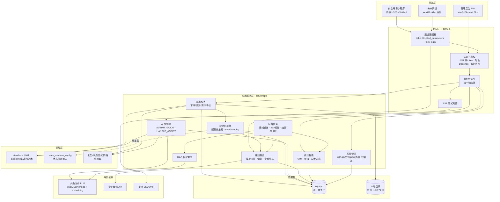
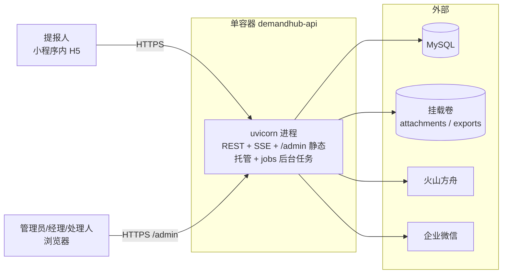

# DemandHub · Java → Python 迁移方案 v2.1

> 版本：v2.1 ｜ 日期：2026-10-12 ｜ 状态：已定稿，待启动 P1
> 关联文档：《DemandHub_架构演进路线_v1.0》（其中"保留 Java PC 页面切契约""Java 不删除"两处口径被本文替代）、《DemandHub_Python重构方案_MVP_v1.0》、《DemandHub_系统数据库设计_v1.0》、《DemandHub_数据库设计_Python栈_v1.0》

---

## 1. 迁移决策（2026-10-11 拍板）

| # | 决策 | 含义 |
|---|---|---|
| 1 | **Java 栈整体废弃** | 微服务架构与程序均不保留、不迭代；其系统设计与功能方案仅作为"翻译蓝本"。全部功能在 Python 模块化单体上重新实现，含一套**全新管理后台**（不复用 Java PC 前端页面） |
| 2 | **按阶段顺序推进** | P0 → P1 → P2 → P3 → P4 → P5 → P6，每阶段独立验收、可上线，e2e 全绿才进入下一阶段 |
| 3 | **历史数据不迁移** | Java 库保留只读归档备查；Python 库从新需求起步；不写迁移脚本、不做双写 |

沿用既有红线（与 Python MVP 一致）：所有流转必写 transition_log；接口 RESTful + 统一响应体；需求编号只由 Python `demand_no_seq` 发放（并发安全、无断号）；系统管理接口限 ADMIN；通知模板变量占位符 + 渲染引擎；状态机配置支持热重载；LLM API Key 仅环境变量注入；LLM 使用 JSON mode。

---

## 2. 现状盘点与差距矩阵

### 2.1 Java 栈（蓝本，将废弃）

微服务套件：gateway（8180）/ system（8081）/ demand（8082）/ notification（8083）/ agent（8084），中间件 MySQL8 + Redis + RocketMQ + MinIO，PC 前端 18 个页面。已实现：渠道 SSO + 账密双登录、JWT 双 token、4 角色族 + 数据范围、12 态状态机（配置热重载）、受理/分派/领取/处理/方案评审/验收全流程、通知模板与偏好 + 企微推送、SLA 预警、demand_stat_daily 统计、异步 Excel 报表、AI 提报引导 + 处理辅助 + RAG 相似推荐。

### 2.2 Python 栈（基线，已上线测试环境）

FastAPI 单服务（:8000，API 根 `/demandhub-api`）+ Vue3/Vant H5 + MySQL + 本地附件目录。已实现：渠道 ticket SSO（+test 参数联调）、需求草稿/提交/撤销、AI 五区要素收集（判型/追问/锚定/粒度治理/概述重写）、快速通道（mode=light/standard）、NEED_INFO 打回闭环、附件（阶段一）、Markdown/XLSX 导出、管理员列表查询。数据表 8 张：dh_user / demand / demand_change_log / demand_no_seq / demand_attachment / agent_session / agent_message / prompt_version。

### 2.3 差距矩阵（Java 有而 Python 无，即迁移对象）

| 功能域 | Java 蓝本 | 迁移阶段 |
|---|---|---|
| 账密登录（BCrypt/锁定/首登改密）、双 token | system/auth | P1 |
| 4 角色族 + 数据范围（角色×组织子树×类型集合） | system + DataScopeInterceptor | P1 |
| 用户/组织/角色授权管理 | system/user、org、grant | P1 |
| 12 态状态机 + ON_HOLD 叠加态 + 流转日志 + 热重载 | demand + state_machine_config | P2 |
| 受理/退回/分派/领取/改型（triage） | demand/triage | P2 |
| 方案评审与多方案对比、评论、工作量、需求关系、拆实例 | demand/solution、comment、effort、relation、split | P2 |
| 验收归档（submit-acceptance / acceptance-review） | demand/demand | P2 |
| AI 处理辅助（HANDLE_ASSIST）+ RAG 相似需求 | agent/assist、agent/rag | P3 |
| 通知中心（站内信/偏好/模板/企微推送） | notification | P4 |
| SLA 预警、统计快照、看板、异步 Excel 导出 | sla_config、demand_stat_daily、report | P4 |
| 字典/需求类型/状态机/SLA/渠道管理 CRUD | demand/admin、system/channel | P5 |
| 全新管理后台前端（18 页面对应能力） | frontend/pc（仅作功能蓝本） | P1~P5 同步 |

---

## 3. 目标架构方案

### 3.1 设计原则

1. **模块化单体**：一个进程、一个数据库；内部按模块分房间，未来要拆随时搬得出去（V4 触发条件出现才拆）。
2. **中间件零新增**：不引 Redis / RocketMQ / MinIO；用 MySQL + 进程内机制 + 本地目录等价替代。
3. **蓝本翻译**：行为语义照 Java 版，实现按 Python 习惯重写；每阶段以移植版 e2e 全绿为门禁。
4. **渠道适配层**：核心业务只认"内部用户 + 渠道标识"，渠道差异挡在适配层（ticket / trusted_parameters / dev-login 已是雏形，新渠道 = 新适配器 + 一条配置）。
5. **单容器可部署**：管理后台前端构建产物由 FastAPI 静态托管，不破坏 H5pub 承载约束。

### 3.2 总体架构图



### 3.3 分层说明

| 层 | 职责 | 关键约束 |
|---|---|---|
| 渠道层 | H5（提报）+ 管理后台 SPA（管理），未来渠道挂接 | 两前端互不感知；H5 保持 480px 壳内约束等既有规范 |
| 接入层 | 渠道适配、认证鉴权、统一响应体、SSE | 核心业务对渠道无感知；统一 `code/message/data` 响应 |
| 应用服务层 | 业务用例编排，事务边界 | 服务间只允许同进程调用，禁止跨库 |
| 领域层 | 要素标准、状态机、判型判质策略 | 纯函数、可单测；YAML/配置表驱动，热重载 |
| 数据层 | MySQL 单库 + 本地附件目录 | Alembic 迁移唯一入口；逻辑删除 is_deleted 沿用 |
| 后台任务 | 进程内 asyncio 定时任务 | 单实例运行即可，失败重试幂等；替代 Java 的 @Scheduled + MQ Consumer |

### 3.4 目标目录结构

```
server/app/
├── api/            # 接入层路由：auth / demand / triage / flow / admin_* / notification / report / agent
├── agent/          # AI 智能体：guide(SUBMIT_GUIDE) / assist(HANDLE_ASSIST) / policy / llm_client / prompts
├── core/           # deps(鉴权/数据范围) / errors / result / security(JWT/BCrypt) / statemachine
├── db/             # models / session
├── domain/         # 领域纯函数（判型判质/编号/渲染）
├── jobs/           # 后台任务：notify_sender / sla_scan / stat_daily / rag_vectorize
├── services/       # demand_service / flow_service / solution_service / notify_service / stat_service ...
├── sso/            # 渠道适配器：chuangjin_ls / trusted_parameters / dev
└── standards/      # 要素标准 YAML（继续为要素标准唯一载体）
frontend/
├── h5/             # 既有：Vue3 + Vant（提报端）
└── admin/          # 新增：Vue3 + Element Plus + Pinia（管理后台，构建产物由 FastAPI 托管于 /admin）
```

### 3.5 数据架构（目标表清单，★ = 新增）

| 域 | 表 | 阶段 |
|---|---|---|
| 用户权限 | dh_user（扩展：login_account/password_hash/status/must_change_pwd/fail_count/locked_until/org_id）、★org（物化路径）、★role_grant、★refresh_token | P1 |
| 需求主档 | demand（扩：assignee_id/hold_snapshot_status 等流转列）、demand_change_log、demand_no_seq、demand_attachment（扩 bizType） | 现有/P2 |
| 流转协作 | ★demand_transition_log、★assignment、★solution、★review、★comment、★effort_log、★demand_relation | P2 |
| 配置中心 | ★demand_type（类型元数据）、★state_machine_config（热重载）、★sla_config、★sys_dict、★channel | P2/P5 |
| 通知中心 | ★notification、★notification_template、★notification_preference、★notify_dedupe（替 Redis 去重） | P4 |
| 统计报表 | ★demand_stat_daily、★report_export_task | P4 |
| AI | agent_session、agent_message、prompt_version、★agent_draft、★rag_vector | 现有/P3 |

三层配置各归其位：**demand_type 表**管类型元数据（编码/名称/绑定状态机 key/启停），**standards YAML** 继续管要素标准与追问话术（Python 既有优势，不入库），**state_machine_config 表**管状态机规则（支持热重载接口）。

### 3.6 中间件替代映射

| Java 组件 | 用途 | Python 替代 | 通俗解释 |
|---|---|---|---|
| RocketMQ | 领域事件（通知/向量化/企微推送异步化） | notification 信箱表 + 进程内后台任务 | 不请快递公司，自设收发室定时跑腿 |
| Redis | 会话/数据范围缓存/票据/SLA 去重 | JWT 无状态 + 进程内 TTL 缓存(60s) + notify_dedupe 表 | 量小，记事本放抽屉即可 |
| MinIO | 附件与导出文件 | 本地目录（已落地，鉴权下载） | 档案柜放自己屋里 |
| Spring 事件 AFTER_COMMIT | 流转后触发通知 | 状态机钩子同事务写信箱表 | 办完手续当场登记，不再转单 |
| @Scheduled | SLA 扫描/统计快照 | asyncio 定时任务（jobs/） | 一个闹钟替代调度系统 |
| MyBatis-Plus 逻辑删除 | is_deleted | SQLAlchemy 沿用同列 | 口径不变 |
| 并发领取 Redis 锁 + 乐观锁 | 防抢单 | 仅 DB 乐观锁（既定降级，内网量级足够） | 人少，排队签字就够 |

### 3.7 部署架构



- 单镜像 + 单库 + 一个挂载卷，H5pub 可承载；
- H5 仍走 H5pub 静态托管（现状不变）；管理后台 SPA 构建产物打进后端镜像，由 FastAPI 托管于 `/admin`；
- 生产核验清单沿用：`channel_entry_auth_mode=ticket`、`auth_dev_login=false`、参数联调模式上线前必须关闭。

---

## 4. 分阶段开发计划

> 通用门禁（每阶段收口必过）：`uv run pytest` 全绿 + `ruff check` 通过 + H5/admin `typecheck` `vitest` `build` 通过 + `scripts/e2e_mvp.py --agent-mode none` 通过 + 本阶段新增 e2e 场景全绿。**提交前必须全量验证**（既定纪律）。

### P0 · 快速通道 + 打回闭环（✅ 已完成，2026-10-11 验收；追问与判质于 2026-10-12 细化）

mode=light/standard、轻量最小集 4 项、NEED_INFO 打回闭环、附件阶段一、口径显性化双标签。基线详见《项目记忆》。

**追问与判质细化（2026-10-12 拍板，v2.1 增补）**——均落在 standards YAML / agent 纯函数层，不动表结构、不影响 P1 起的数据与服务设计：

- **急单门控**：紧急度为紧急/特急且期望交付时间空时，插队最优先追问日期（承接"紧急请说明期望时间"承诺，点选快捷项只发枚举标签无时间信息可抽）；日期填上/问满即恢复。仅 TECH 生效，普通档不问、light 不门控。
- **歧义词长句豁免**：vague_words 子串匹配只在短句（<18 字）且以模糊词为主体时判 VAGUE；长句里"方便/体验"多为正常结果陈述（"…导致阅读体验较差"）不误伤；"体验""满意"移出三标准词表。
- **验收承认行为结果**：D8 合格条件在数字指标之外，并列承认可逐条核对的行为结果（可直接打开/正常显示/不再报错/无需手工/恢复正常等），修复"体验修复类验收无数字被误判不可检验"。
- **可提交即停问软质量**：必填门槛达成（AI 已说"可以提交"）后，非空但被判"不够量化"的必填项不再主动追问，兑现"不影响提交、以后能补"；完善提示留表单卡片由用户/产品经理自愿补，质量兜底交给 P2 的受理打回机制。MISSING（真空着）不受此限仍追问。
- **日期锚点**：submit_guide 提示词注入"今天是 YYYY-MM-DD"，省略年份的日期（10/30、月底前）以今天为基准换算，今年已过顺延明年；规则层拦截早于今天的交付日期。
- **追问话术明示意图**：痛点问句前缀"关于『现在最麻烦的事』"、验收前缀"关于『怎样算做完』"，用户可直观知道 AI 在问哪个要素。

---

### P1 · 账号与权限 + 管理后台骨架

**目标**：管理端可以登录、按角色管人管权限；管理后台前端骨架立起来，后续阶段的页面有"房子"可住。

**① 数据（alembic 0005）**
- `dh_user` 增列：login_account(uk) / password_hash / status(ACTIVE/DISABLED) / must_change_pwd / fail_count / locked_until / org_id；
- 新表 `org`（id/parent_id/name/path 物化路径/status）；`role_grant`（id/user_id/role/org_id/type_scope JSON）；`refresh_token`（id/user_id/token_hash/expires_at/revoked）。

**② 后端**
- auth 扩展：`POST /auth/login`（BCrypt、失败 5 次锁 15 分钟、首登强制改密）、`POST /auth/change-password`、`POST /auth/refresh`（旋转、旧 token 吊销）、`POST /auth/logout`、`GET /auth/me`（返回角色+数据范围）；
- 权限基建：`RequireRole` Depends（ADMIN/EXECUTIVE/MANAGER/HANDLER，ADMIN 直通）、数据范围查询依赖（组织物化路径前缀 × 类型集合，EXECUTIVE/ADMIN bypass，进程内 60s TTL 缓存）；
- 管理接口：`/admin/users`（分页/激活/禁用/重置密码/合并）、`/admin/orgs`（树查询 + CRUD，删除前子树/用户/引用校验）、`/admin/grants`（分页 + CRUD）；出参手机/邮箱脱敏。

**③ 管理后台前端（frontend/admin 新建）**
- 脚手架：Vite + Vue3 + TS + Element Plus + Pinia + vue-router + axios（统一响应体拦截器、401 跳登录）；
- 页面：登录页、主布局（侧边菜单 + 顶栏用户区）、用户管理、组织树管理、角色授权管理；
- 路由 meta.roles 页面级鉴权；构建产物接入 FastAPI `/admin` 静态托管。

**④ 验收**
- 单测：登录锁定/强制改密/refresh 旋转吊销/越权 403/数据范围过滤/组织删除校验；
- e2e：管理员登录 → 建组织 → 授权 → 被授权人可见范围正确；
- 回归：既有 H5 渠道 SSO 链路零影响。

---

### P2 · 状态机与全流程流转

**目标**：需求从"提交即终态"变为"受理→分派→处理→方案评审→验收→归档"全流转，行为与 Java 蓝本一致。

**① 数据（alembic 0006/0007）**
- `demand` 增列：assignee_id / hold_snapshot_status（ON_HOLD 叠加态，不占主状态列）/ confirmed_at / done_at；
- 新表 `state_machine_config`（key/json/version，热重载）、`demand_transition_log`（每次流转必写，硬约束）、`assignment`、`solution`、`review`、`comment`（仅作者可改、不可删）、`effort_log`、`demand_relation`（PARENT/DEPENDS/DUPLICATE/SPLIT）。

**② 后端**
- 状态机引擎（core/statemachine）：配置表加载 + `/admin/state-machines/reload` 热重载；规则含角色校验（ADMIN 直通）；非法流转统一错误码；
- triage：`GET /triage/queue|pool`、`POST /triage/{id}/accept|return|close|assign`、`POST /triage/{id}/claim`（DB 乐观锁防抢单）、`change-type`；
  - 受理打回承接 P0 新口径（2026-10-12）：提报侧"可提交即停问软质量"后，**要素质量的最终把关在受理环节**——受理人发现痛点/验收等不够具体时用 `return`（→ NEED_INFO）打回并附原因，与 P0 打回闭环同一链路；
- 流转：`/demand/{id}/start|hold|resume|submit-acceptance|acceptance-review|split`；HOLD/RESUME 写叠加态；
- 协作：solution（提交评审/评审/多方案 compare）、comment、effort（含 summary）、relation；拆实例落库（激活既有 ext.pendingSplits → split_from_id/split_group_id）；
- 附件 bizType 扩展：DRAFT/DEMAND/SOLUTION/COMMENT（限额届时拍板是否对齐 Java 50MB/20 个）。

**③ 前端**
- 管理后台：受理分派工作台（队列/池/计数）、处理人工作台、管理视角需求详情（状态时间线 + 流转按钮按角色显隐 + 方案/评论/工作量/关系标签页）；
- H5：提报人视角状态时间线（详情页）、状态变更回执播报。

**④ 验收**
- 单测：12 态全路径、非法流转拒绝、ON_HOLD 快照恢复、领取并发（双请求仅一成功）、solution 评审状态联动；
- e2e：提报 → 受理 → 分派/领取 → 方案评审通过 → 处理 → 验收通过 → DONE；退回 → NEED_INFO → 重提闭环（与 P0 打回衔接）。

---

### P3 · AI 处理辅助 + RAG

**① 数据**：`agent_draft`（处理辅助草稿）、`rag_vector`（demand_id/embedding JSON/向量化时间）。
**② 后端**：agent 新增 HANDLE_ASSIST 场景（HANDLER 以上）：`POST /agent/assist/questions|solution`、`GET /agent/assist/drafts`、`POST /agent/assist/drafts/{id}/confirm|discard`；embedding 配置位启用，`GET /agent/rag/similar`（Top N≤10，余弦阈值 0.08）；DONE 需求由后台任务异步向量化；LLM 熔断冷却、JSON mode 沿用。
**③ 前端（管理后台）**：处理辅助面板（提问/方案草稿确认）、相似需求卡片。
**④ 验收**：辅助输出不落正式表（草稿确认才落）；相似推荐按阈值过滤；mock LLM 下 e2e 通过。

---

### P4 · 通知与统计

**① 数据**：`notification`、`notification_template`、`notification_preference`（TODO 类不可关）、`notify_dedupe`、`sla_config`、`demand_stat_daily`、`report_export_task`。
**② 后端**
- 通知：状态机钩子同事务写信箱（18 事件→7 类通知映射照蓝本）；Jinja2 模板渲染（变量占位符，硬约束）；后台任务发送 + 指数退避重试；企微推送（保留 mock 模式自测）；
- 接口：`GET /notification/mine|unread-count`、`PUT read|read-all`、偏好 GET/PUT、模板 CRUD + preview（ADMIN）；
- SLA：黄/红两档定时扫描，notify_dedupe 表去重（7 天）；
- 统计：每日增量聚合 demand_stat_daily；`GET /dashboard/manager|org`；异步 Excel 导出（任务表 + 后台生成 + `/report/download/{taskId}`）。
**③ 前端**：管理后台通知中心（列表/未读/全部已读/偏好）、经营与经理看板、报表导出页、通知模板管理；H5 列表未读角标（可选）。
**④ 验收**：事件→通知映射全覆盖测试；重试幂等（重复发送不重复落信）；SLA 扫描去重；看板数据与快照一致；导出任务异步可下载。

---

### P5 · 系统管理补全

**① 数据**：`sys_dict`、`demand_type`、`channel`（含部门映射校准表 channel_dept_unmapped）。
**② 后端**：字典/需求类型/状态机/SLA/渠道 ADMIN CRUD 全套；状态机 `/default-json` `/reload`；渠道启停与配置、部门未映射校准接口。
**③ 前端（管理后台）**：字典管理、需求类型管理、状态机管理（JSON 编辑 + 热重载）、SLA 配置、渠道管理五个页面。
**④ 验收**：ADMIN 以外全 403；状态机热重载后新规则即时生效（不重启）；类型绑定状态机 key 校验。

---

### P6 · 门禁核对与 Java 下线

- 移植版 e2e 套件全量绿（以 Java 31 项验收场景为基线逐条核对，覆盖不到的注明原因）；
- 配置审计：生产环境 ticket 模式、dev-login 关闭、LLM Key 注入方式、备份脚本演练一次；
- Java 处置：test 栈停机归档，`backend/` 与 `frontend/pc` 打 tag 后从主分支移除（或移入 archive/ 目录，届时拍板）；
- Java 数据库：账号降只读，保留备查（决策三：不迁移数据）。

---

## 5. 风险与应对

| 风险 | 应对 |
|---|---|
| 行为与蓝本不一致 | 每阶段移植 e2e 全绿为门禁，不凭感觉；状态机/权限以 Java 规则为测试基线 |
| 单进程后台任务可靠性 | 任务幂等 + 失败重试 + 落库断点；单实例部署约定写进运维清单 |
| 数据范围过滤漏判 | 查询依赖统一收口（禁止绕过），配越权访问负例测试 |
| 管理后台与 H5 会话混用 | 独立登录页 + 独立 token 命名空间；H5 渠道 SSO 链路不改 |
| 阶段蔓延 | 每阶段范围以本文任务清单为准，新诉求记入下一阶段触发条件 |

## 6. 术语白话表

| 术语 | 一句话解释 |
|---|---|
| 模块化单体 | 一个程序内部房间分隔清楚，想拆随时搬得出去 |
| 蓝本翻译 | 照 Java 版的设计语义，在 Python 里重新实现同一行为 |
| 物化路径 | 组织架构用"根/一级/二级"路径串表示，查子树就是前缀匹配 |
| 数据范围 | 你能看哪些需求 = 角色 × 组织子树 × 类型集合三道筛子 |
| ON_HOLD 叠加态 | "挂起"不是独立状态，而是给当前状态贴张"暂停"标签，恢复时撕掉回到原状态 |
| 乐观锁 | 更新时带版本号，对不上就拒绝——两个人抢同一单只有一人成功 |
| 信箱表 | 通知先登记进表，后台任务再逐条派送，重试也不丢 |
| 热重载 | 改配置不重启程序即生效 |
| e2e 测试 | 模拟真实用户从点击到落库的全链路自动验收脚本 |
