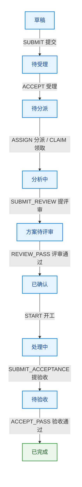
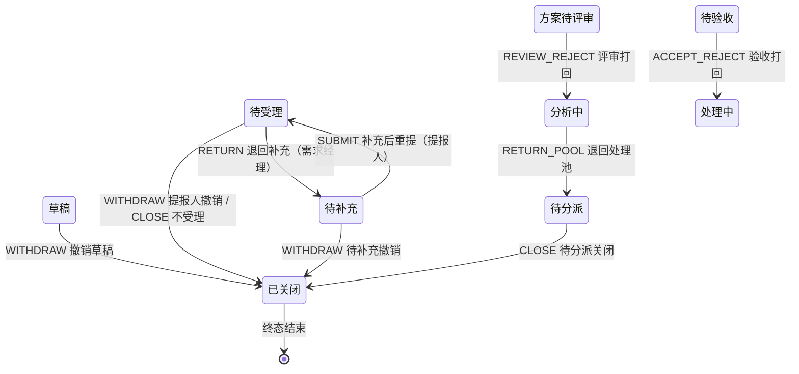
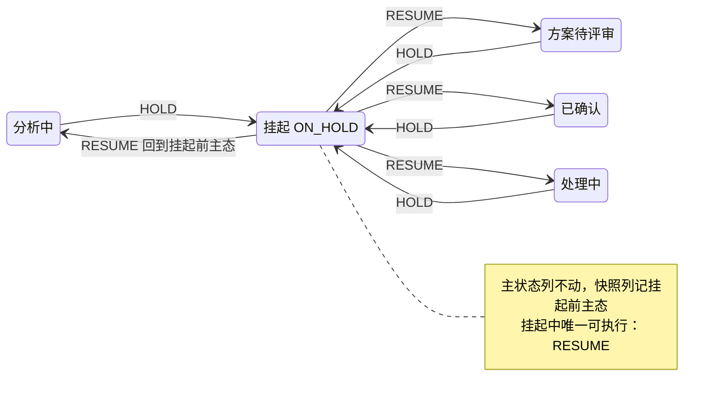
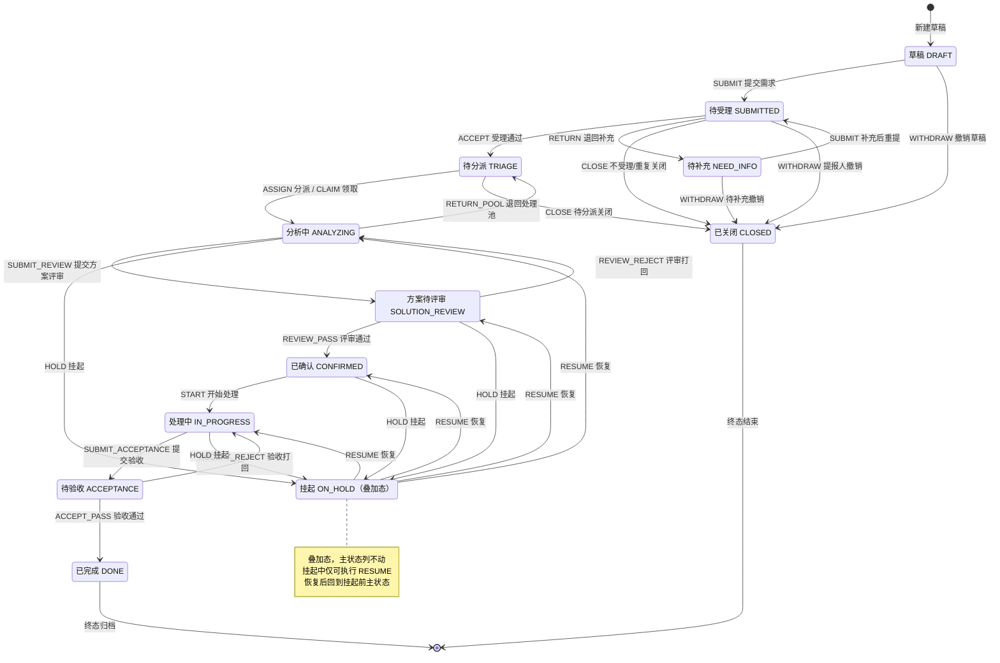

# DemandHub 状态机说明文档

> 当前版本：v1.1 ｜ 更新时间：2026-10-18

| 版本 | 日期 | 说明 |
|---|---|---|
| v1.0 | 2026-10-13 | 基于 P2 落地实现整理，与代码口径一致（引擎 + 32 条规则） |
| v1.1 | 2026-10-18 | P4 角色扩展口径重整理：受理族→MANAGER、类型修正→EXECUTIVE、可代办族→HANDLER/MANAGER（对齐 0009 迁移与引擎 DEFAULT_RULES）；业务归属列按服务层代码现状修正（类型权限、START/提验收仅处理人本人等） |

> 白话导读：全系统**只有 1 个真正的状态机**——需求 12 态主流程。它像地铁线路图：需求是列车，状态是站点，事件是车次，只有买到"规则车票"（状态机规则 + 角色 + 业务归属三重校验都通过）才能进站发车，每次进出站都登记（transition_log 留痕）。方案、草稿等对象也有状态，但只是"小告示牌"，不算独立状态机（见第 7 节）。

---

## 1. 状态枚举（12 态）

| 状态码 | 中文（管理后台口径） | 中文（H5 提报人口径） | 含义 | 谁在此时有动作 |
|---|---|---|---|---|
| DRAFT | 草稿 | 草稿 | 提报人编辑中，未提交 | 提报人：提交/撤销 |
| SUBMITTED | 待受理 | 已提交 | 已提交，等经理受理 | 需求经理：受理/打回/关闭；提报人：撤销 |
| NEED_INFO | 待补充 | 待补充 | 被打回，等提报人补充 | 提报人：重提/撤销；需求管理者：改型 |
| TRIAGE | 待分派/待领取 | 已受理 | 受理通过，进处理池 | 需求经理：分派/关闭；处理人：领取 |
| ANALYZING | 分析中 | 分析中 | 处理人分析需求、写方案 | 处理人：提评审/退单/挂起（经理可代办） |
| SOLUTION_REVIEW | 方案待评审 | 方案评审中 | 方案已提交，等经理评审 | 需求经理：通过/打回 |
| CONFIRMED | 已确认/已排期 | 方案已确认 | 方案评审通过，待开工 | 处理人：开始处理/挂起 |
| IN_PROGRESS | 处理中 | 处理中 | 正在实施 | 处理人：提交验收/挂起 |
| ACCEPTANCE | 待验收 | 待验收 | 交付物已提交，等提报人验收 | 提报人：通过/打回 |
| DONE | 已完成 | 已完成 | 终态，验收通过归档 | 无 |
| CLOSED | 已关闭 | 已撤销 | 终态，撤销/不受理/重复 | 无 |
| ON_HOLD | 挂起（叠加态） | 挂起 | 非主状态，叠加在 4 个在途态之上 | 处理人/需求经理：恢复 |

**口径说明**：同一条数据，管理后台与 H5 看到的中文名不同（如 TRIAGE 管理端叫"待分派"，提报人看到的是"已受理"），英文状态码全系统唯一。

---

## 2. 状态机图

为便于阅读，按"先看主干、再看旁路、最后看挂起"拆成三张图，每张子图节点少、更醒目；完整总图附在 2.4 备查。在 VS Code / Typora 等预览器里点击图片可放大查看。

### 2.1 主流程（Happy Path）

一眼看全（三行蛇形，读到行尾换下一行）：

```text
草稿 → 待受理 → 待分派 ↓
分析中 → 方案待评审 → 已确认 ↓
处理中 → 待验收 → 已完成
```



### 2.2 旁路与异常流转（打回 / 退单 / 撤销 / 关闭）



### 2.3 挂起与恢复（ON_HOLD 叠加态）



### 2.4 完整总图（备查）



**各图均未画出**（避免线条过密，见第 3 节表格）：
- `CHANGE_TYPE`（类型修正）：SUBMITTED ~ ACCEPTANCE 共 8 个在途态的自环，主状态不变，仅需求管理者（EXECUTIVE）可用。
- `SPLIT`（拆分）：业务动作非引擎规则，受理后在途态（TRIAGE/ANALYZING/SOLUTION_REVIEW/CONFIRMED/IN_PROGRESS）可用，由服务层手动加入可用操作（当前处理人或 ADMIN）。

---

## 3. 合法流转表（32 条引擎规则 + 业务归属校验）

角色列是状态机的第一道闸；**业务归属**是第二道闸（在服务层校验，状态机不管）。

**角色码对照**：ADMIN=系统管理员（超级用户）、EXECUTIVE=需求管理者、MANAGER=需求经理、HANDLER=处理人、REPORTER=提报人（不参与任何状态机规则，登录即可提报）。一个人的有效角色 = 账号主角色（dh_user.role）∪ 生效授权（demand_role_grant），任一命中即算持有该角色。

**可见性兜底**（flow_service.can_view_demand）：ADMIN 全量；提报人看本人；HANDLER/MANAGER/EXECUTIVE 仅可见已进入流转的需求（SUBMITTED 起，DRAFT/NEED_INFO 为提报人私有编辑态）；非本人提交的单还要过类型权限（dh_user.type_scope），越权一律按"不存在"（1001）处理，不暴露单的存在性。

| 当前状态 | 事件 | 下一状态 | 角色要求 | 业务归属校验（服务层） | 入口 API |
|---|---|---|---|---|---|
| DRAFT | SUBMIT 提交需求 | SUBMITTED | 不限 | 仅提报人本人；乐观锁 revision | `POST /demand/{id}/submit` |
| DRAFT | WITHDRAW 撤销草稿 | CLOSED | 不限 | 仅提报人本人；原因必填 | `POST /demand/{id}/close` |
| SUBMITTED | WITHDRAW 提报人撤销 | CLOSED | 不限 | 仅提报人本人；原因必填 | `POST /demand/{id}/close` |
| SUBMITTED | ACCEPT 受理通过 | TRIAGE | MANAGER | 类型权限：操作人须覆盖该单类型（ADMIN 直通） | `POST /triage/{id}/accept` |
| SUBMITTED | RETURN 退回补充 | NEED_INFO | MANAGER | 原因必填（进 ext.returnReason 给提报人看）；类型权限校验 | `POST /triage/{id}/return` |
| SUBMITTED | CLOSE 不受理/重复关闭 | CLOSED | MANAGER | 原因必填；重复关闭可填 duplicateOfId 建 DUPLICATE 关系；类型权限校验 | `POST /triage/{id}/close` |
| NEED_INFO | SUBMIT 补充后重提 | SUBMITTED | 不限 | 仅提报人本人；重提成功清 ext.returnReason | `POST /demand/{id}/submit` |
| NEED_INFO | WITHDRAW 待补充撤销 | CLOSED | 不限 | 仅提报人本人 | `POST /demand/{id}/close` |
| TRIAGE | ASSIGN 经理分派 | ANALYZING | MANAGER | 被分派人须 ACTIVE 且有效角色含 HANDLER（或 ADMIN）；经理与被分派人双方类型权限均须覆盖该单类型；写 Assignment 留痕 | `POST /triage/{id}/assign` |
| TRIAGE | CLAIM 处理人领取 | ANALYZING | HANDLER | **数据库行锁防抢单**：并发领取仅一人成功，其余报 1208；类型权限校验；写 Assignment 留痕 | `POST /triage/{id}/claim` |
| TRIAGE | CLOSE 待分派关闭 | CLOSED | MANAGER | 原因必填；类型权限校验 | `POST /triage/{id}/close` |
| ANALYZING | SUBMIT_REVIEW 提交方案评审 | SOLUTION_REVIEW | HANDLER/MANAGER | 当前处理人本人，或经理代办 / ADMIN；须有本版本方案且无在评方案 | `POST /solution/{id}/submit-review` |
| ANALYZING | RETURN_POOL 退回处理池 | TRIAGE | HANDLER/MANAGER | 当前处理人退单，或经理 / ADMIN 收回；原因必填；清空处理人 | `POST /triage/{id}/return-pool` |
| SOLUTION_REVIEW | REVIEW_PASS 评审通过 | CONFIRMED | MANAGER | 方案置 APPROVED 留痕；写 confirmed_at/expect_delivery_at | `POST /solution/{id}/review` |
| SOLUTION_REVIEW | REVIEW_REJECT 评审打回 | ANALYZING | MANAGER | 意见必填；方案置 REJECTED 留痕，打回后可重提 | `POST /solution/{id}/review` |
| CONFIRMED | START 开始处理 | IN_PROGRESS | HANDLER | 仅当前处理人本人（ADMIN 也不代办） | `POST /demand/{id}/start` |
| IN_PROGRESS | SUBMIT_ACCEPTANCE 提交验收 | ACCEPTANCE | HANDLER | 仅当前处理人本人（ADMIN 也不代办）；**三前置**（缺一报 1209，按序拼接提示）：方案已确认、工时已填报、交付物已上传 | `POST /demand/{id}/submit-acceptance` |
| ACCEPTANCE | ACCEPT_PASS 验收通过 | DONE | 不限 | 仅提报人本人；**双评分必填**（质量/满意度各 1-5 分）；写 done_at 与评分 | `POST /demand/{id}/acceptance-review` |
| ACCEPTANCE | ACCEPT_REJECT 验收打回 | IN_PROGRESS | 不限 | 仅提报人本人；打回意见必填 | `POST /demand/{id}/acceptance-review` |
| 8 个在途态¹ | CHANGE_TYPE 类型修正 | 主状态不变 | EXECUTIVE | 新类型必须合法且与原类型不同；原类型与新类型均须在操作人类型权限内（ADMIN 直通）；subtype 置空重收集；承接组织随新类型默认组织重路由；留痕 extra 记 fromType→toType | `POST /triage/{id}/change-type` |
| 4 个在途态² | HOLD 挂起 | 主状态不变（叠加 ON_HOLD） | HANDLER/MANAGER | 当前处理人，或经理 / ADMIN；原因必填 | `POST /demand/{id}/hold` |
| ON_HOLD | RESUME 恢复 | 回到挂起前主状态 | HANDLER/MANAGER | 当前处理人，或经理 / ADMIN 代恢复 | `POST /demand/{id}/resume` |

> ¹ SUBMITTED、NEED_INFO、TRIAGE、ANALYZING、SOLUTION_REVIEW、CONFIRMED、IN_PROGRESS、ACCEPTANCE。
> ² ANALYZING、SOLUTION_REVIEW、CONFIRMED、IN_PROGRESS。
>
> **ADMIN 直通**：状态机角色校验对 ADMIN 一律放行（蓝本超级用户口径，不写入规则）；API 层的角色守卫（require_role 工厂）同样 ADMIN 直通。注意 START / SUBMIT_ACCEPTANCE 的业务归属是"仅处理人本人"，ADMIN 无例外——超级用户也不能替处理人开工、提验收。
>
> **类型权限（2026-10-16 拍板）**：EXECUTIVE/MANAGER/HANDLER 按 dh_user.type_scope 限定可管的需求类型；动作类接口显式校验（越权报 1126），列表/详情按权限过滤（越权按不存在处理）；ADMIN 全类型直通，REPORTER 提报不受限。

---

## 4. ON_HOLD 叠加态（两列方案）

挂起不是第 12 个主状态，而是"贴在主状态上的便签"：

- **实现**：`demand.status` 主状态列**不动**；`hold_snapshot_status` 记下挂起前主态、`hold_reason` 记原因。`hold_snapshot_status` 非空即视为挂起中。
- **规则匹配视角**：挂起中需求按 `ON_HOLD` 匹配规则——此时**唯一可执行的事件是 RESUME**，其他事件一律拒绝。
- **恢复**：RESUME 把主态恢复到 `hold_snapshot_status` 记录的值，清空快照与原因。
- **留痕**：HOLD/RESUME 都写 transition_log（hold_flag=true），HOLD 的 toStatus 记为 ON_HOLD。
- **SLA**：挂起期间 SLA 计时暂停（P4 实现 SLA 时按此口径）。

---

## 5. 引擎实现机制

| 机制 | 做法 | 白话 |
|---|---|---|
| 规则落库 | `state_machine_config` 表存 JSON 规则（config_key 区分多套配置，当前仅 DEFAULT 一套 32 条） | 流程图存在数据库里，不靠改代码 |
| 热重载 | `POST /admin/state-machines/reload`（ADMIN）重新加载，进程内缓存整体不可变替换 | 改流程不用重启服务 |
| 单条容错 | 某条配置解析失败：跳过该 key、保留上一份可用配置，不整体回滚 | 一条写坏不拖垮全部 |
| 兜底 | 配置表为空时回落代码内置 DEFAULT_RULES（与种子一致） | 表被清空系统也能跑 |
| 并发安全 | transition 内 `SELECT ... FOR UPDATE` 行锁串行化；乐观锁 revision +1 | 两个人同时操作同一需求不会串线 |
| 留痕 | 每次流转写 `demand_transition_log`（from/to/event/操作人快照/原因/holdFlag） | 全程可审计 |
| 非法流转 | 统一报 1001，错误消息含中文状态名与事件名（如"当前状态[已完成]不允许执行[提交验收]"） | 拒绝原因人话可读 |
| 终态保护 | DONE/CLOSED 无任何出边规则，天然拒绝一切事件 | 终态不可复活 |

**唯一入口**：所有状态变更必须经 `engine.transition()`，禁止任何地方直接 `update status`。

---

## 6. 多配置预留（当前未启用）

- `config_key` 支持多套流程并存，引擎所有方法（find_rule / available_events / transition）都接受 config_key 参数，缺省走 DEFAULT。
- 设计意图：未来不同类型需求可走不同流程（如培训类跳过验收）。
- 开放时间：P5（系统管理补全）"需求类型绑定状态机 key 校验"落地后可用；一期三类需求共用 DEFAULT。

---

## 7. 附属小生命周期（不是独立状态机）

这些对象的状态由服务代码硬控制，不走引擎、不写 transition_log：

| 对象 | 状态流转 | 控制点 |
|---|---|---|
| 方案 Solution | DRAFT → SUBMITTED → APPROVED / REJECTED（打回后可再提新版本） | solution_service：仅 ANALYZING 可建/改；仅作者可改 DRAFT；在评唯一 |
| AI 辅助草稿 AgentDraft（P3 规划） | PENDING → CONFIRMED / DISCARDED（单向） | 非 PENDING 操作拒绝 |
| 用户 User | ACTIVE ⇄ DISABLED | 系统管理员（ADMIN）启停 |
| 通知/报表导出任务（P4 规划） | PENDING → SENT / FAILED | 后台任务 |

---

## 8. 代码位置索引

| 内容 | 位置 |
|---|---|
| 状态机引擎（规则/校验/流转/留痕） | `server/app/core/statemachine/engine.py` |
| 32 条内置规则 + 种子 | 引擎 `DEFAULT_RULES`；`server/alembic/versions/0006_statemachine_flow.py`；`0009_role_expand.py`（P4 角色重映射：受理族→MANAGER、改型→EXECUTIVE、可代办族→HANDLER/MANAGER） |
| 业务归属校验与流转服务 | `server/app/services/flow_service.py`、`triage_service.py` |
| 流转 API | `server/app/api/demand.py`（flow 段）、`triage.py`、`solution.py` |
| 热重载 API | `server/app/api/admin_statemachine.py` |
| 中文状态/事件名 | 引擎 `STATUS_LABELS` / `EVENT_LABELS` |
| 前端展示口径 | 管理后台 `frontend/admin/src/utils/status.ts`；H5 `frontend/h5/src/utils/format.ts` |
| 需求口径文档 | 根目录《DemandHub_系统需求规格说明书_SRS_v1.0.md》第 5 节 |
