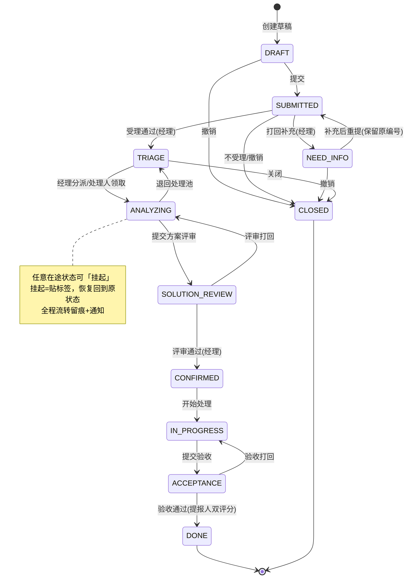

# DemandHub 系统功能说明文档 V1.0

| 项目 | 说明 |
|---|---|
| 版本 | V1.0（对应代码基线：P0~P5 全部落地，alembic 0010） |
| 日期 | 2026-10-14 |
| 系统定位 | 创金合信基金零售业务线的需求管理系统：以 AI 对话方式帮助业务人员把需求"说清楚、填完整"，再经状态机驱动的标准流程完成受理、分析、方案评审、处理与验收闭环 |
| 配套文档 | 《DemandHub_系统架构文档_V1.0.md》（技术架构与演进方向） |

---

## 1. 系统概述

### 1.1 用户角色

| 角色 | 身份 | 主要使用端 |
|---|---|---|
| 提报人 | 业务线员工（无独立账号，经创金零售渠道免登进入） | H5 |
| HANDLER 处理人 | 科技/物料/培训需求的实际办理者 | 管理后台 |
| MANAGER 经理 | 受理分派、方案评审、团队管理 | 管理后台 |
| EXECUTIVE 高管 | 经营视角看板、类型修正 | 管理后台 |
| ADMIN 管理员 | 超级管理员，对所有业务操作与数据范围直通 | 管理后台 |

### 1.2 功能地图

```
DemandHub V1.0
├── H5 提报端（嵌入创金零售宿主）
│   ├── AI 对话式需求提报（chat-first）
│   ├── 我的需求（列表/状态跟踪/撤销/补充重提）
│   ├── 需求详情（进度/要素/附件/验收）
│   └── 需求整理（管理员视图，筛选+导出）
├── PC 管理后台
│   ├── 我的处理（任务池/在办/挂起）
│   ├── 受理分派（待受理队列 + 已受理池）
│   ├── 需求管理（列表/详情/方案评审/工时/关联）
│   ├── 通知中心（站内信/偏好）
│   ├── 看板与报表（经营看板/组织看板/异步导出）
│   └── 系统配置（用户/授权/字典/类型/状态机/SLA/渠道/组织/通知模板）
├── AI 能力
│   ├── 提报启发（要素抽取/判型/口径判定/追问/概述）
│   ├── 处理辅助（调研问题/方案初稿）
│   └── 相似需求推荐（RAG）
└── 平台机制
    ├── 状态机引擎（规则可配、热重载、全程留痕）
    ├── 通知引擎（18 类事件、模板渲染、超时告警）
    └── SLA 与统计（黄红档扫描、看板快照）
```

---

## 2. H5 提报端功能详述

### 2.1 AI 对话式需求提报（首页 /report）

| 功能点 | 说明 |
|---|---|
| 四步引导 | StepsBar 展示「表达→拆解→追问→提交」，按会话状态自动推进 |
| AI 流式对话 | 逐字输出（SSE），支持失败重试、快捷回复选项 |
| 五区要素实时拆解 | FormSnapshotCard 嵌在聊天流中：A 基本信息 / B 业务区 / C 用户故事区 / D 验收实现区；默认折叠，只显示进度（必填 X/12 · 业务 Y/4）与归类标签 |
| 智能判型 | AI 自动判断 业务需求/用户日常/功能需求，业务需求激活 B 区 4 项必填；「归类」标签可点击改判（逃生口） |
| 双提报口径 | 常规 12 项必填；微需求自动识别为「轻量提报」仅 4 项（原话+标题+紧急度+期望效果），用户可在「归类与口径」面板双向改判；首判轻量时 AI 会明说"按轻量提报帮你登记" |
| 智能追问 | A/C/D 基础项问完才问 B 区；急单（紧急/特急）未填期望时间时优先追问交付日期；已满足提交门槛后不再纠缠措辞质量（留给打回兜底）；追问话术锚定已填内容，明说在问哪一项 |
| 逐字段手改 | 点字段胶囊弹出编辑层，确认即落库；AI 随后播报"哪项从什么改成了什么"，且该变更进入对话上下文防止 AI 用旧值 |
| 示例复制 | 一句话示例「复制示例」按钮，只复制到剪贴板，不自动发送、不污染原话 |
| 附件上传 | 聊天「+」按钮：图片/文档（pdf/word/ppt/md），单文件 10MB、每需求 5 个，魔数校验防伪装；AI 不识别附件内容，仅作需求附件存档 |
| 草稿 | 自动保存；冲突提示；草稿可直接提交 |
| D9 建议方案 | 用户提的候选方案/选型如实记入「建议方案」区（选填，AI 首抽时播报"记到建议方案里了，由产品和技术评估后再定"），不会被静默丢弃 |

### 2.2 我的需求（/mine）

- 状态 Tab：全部/草稿/已提交/待补充/已撤销；下拉刷新+分页加载。
- 草稿可继续编辑；已提交可填原因撤销；被打回的需求带「待补充」角标。
- 顶栏「通知」入口带未读角标。

### 2.3 需求详情（/demand/:id）

- 状态回执横幅（与上次查看状态比对，有变化即播报）；挂起提示。
- 需求概述（AI 四段摘要）+ 后续补充原话；处理进度时间线（每次流转留痕）。
- 五区要素分区展示，未提取到的分区显示「暂未提取到信息，待补充。」；信息完备度清单。
- 附件下载/删除（草稿态）；AI 对话回放折叠卡。
- 操作：草稿继续编辑、打回后「去补充，重新提交」（保留原编号）、撤销、**验收**（待验收时：验收通过需打质量+满意度双评分 / 验收打回）、下载 Markdown。
- 管理员额外可见「打回补充」（必填原因）。

### 2.4 需求整理（/admin，仅管理员）

- 按类型/状态/日期筛选的分页列表；导出 XLSX（与筛选条件联动）。

---

## 3. PC 管理后台功能详述

### 3.1 账户与登录

- 仅账密登录（与 H5 渠道 SSO 互不干扰）；失败 5 次锁 15 分钟；首登强制改密（≥8 位）。
- 登录后按角色呈现不同菜单；顶栏显示当前角色，头像下拉退出。

### 3.2 我的处理（全员）

- **任务池**：未被领取的需求，处理人可主动领取。
- **我的在办**：我名下的需求列表；支持挂起（填原因，状态贴"挂起"标签）与恢复（回到挂起前状态）。
- 处理动作入口：开始处理、提交验收等按状态出现。

### 3.3 受理分派（经理族 + ADMIN）

双区工作台：

- **待受理队列**：新提交需求 → 受理通过（进 TRIAGE）/ 打回补充（填原因，提报人 H5 收通知并走补充闭环）/ 不受理关闭。
- **已受理池**：分派处理人 / 改型（类型修正，高管权限）/ 关闭（可标记重复单）。
- 队列计数角标；行锁保证同一需求不会被两人同时领取。

### 3.4 需求列表与详情

- 列表：多条件筛选（状态/类型/紧急度/关键字/时间）+ 分页。
- 详情页头：状态机动作按钮按当前状态动态渲染（受理/分派/打回/关闭/改型/挂起/恢复/提交评审/评审通过与打回/开始处理/提交验收）。
- 信息卡区块：概览（AI 摘要）、通用区、五区要素、扩展信息、附件、AI 对话回放。
- 六个 Tab 面板：
  1. **方案**：多版本管理、提交评审、评审通过/打回、版本间对比；
  2. **AI 辅助**：AI 生成调研问题与方案初稿（草稿区确认后入库）、相似需求推荐（基于已完成需求向量召回）；
  3. **沟通记录**：评论留言；
  4. **工时填报**：工时登记与汇总；
  5. **需求关联**：建立/解除需求间关系（关系类型+方向）；
  6. **处理进度**：完整流转时间线。

### 3.5 通知中心

- 站内信列表（事件类型 18 种，含提交、受理、打回、分派、评审、验收、SLA 黄红档告警等 7 大类）；单条已读/全部已读；偏好设置（按类型开关）。
- 顶栏铃铛 30 秒轮询未读数；提报人自己操作不给自己发通知（操作人剔除）。

### 3.6 看板与报表

- **经营看板**（经理族）：本周/本月/本季/自定义范围，提交量/完成量/在途量/平均时长等指标卡 + ECharts 趋势与分布图。
- **组织看板**：按提报部门快照分组 Top10 + 成员在途/工时排行表（数据每 5 分钟快照一次，也可手动刷新）。
- **报表导出**：按状态/类型/紧急度/关键字/时间/范围新建导出任务，后台异步生成 Excel，完成后下载（任务列表轮询）。

### 3.7 系统配置（仅 ADMIN）

| 配置域 | 功能点 |
|---|---|
| 用户管理 | 建号（初始密码+强制改密）、禁用/启用（吊销全部令牌）、重置密码、改角色；列表分页/搜索/筛选；手机邮箱脱敏；不能禁用或重置自己 |
| 角色授权 | 在静态角色之外按「类型范围」授予补充角色（有效角色=并集） |
| 通知模板 | 模板变量占位+渲染预览；按事件维护文案 |
| 字典管理 | 通用字典项维护（sys_dict） |
| 需求类型 | 类型注册/启停/排序；绑定默认承接组织与状态机 key；五区字段内容仍走 yaml 标准 |
| 状态机管理 | 查看当前规则集 JSON、编辑规则、手动热重载（不重启生效）、查看内置默认规则 |
| SLA 配置 | 按「类型+状态」设预警（黄档）/告警（红档）分钟数；后台 30 秒扫描，7 天内同一告警不重复打扰 |
| 渠道管理 | H5 接入渠道登记/启停/回调开关；渠道部门未映射清单 |
| 组织管理 | 组织树 CRUD（物化路径存储），可挂企微部门 ID |

---

## 4. AI 能力说明（白话版）

| 能力 | 干什么 | 边界（用户需知） |
|---|---|---|
| 提报启发 | 边聊边把原话拆成结构化要素，缺什么问什么 | AI 的判断都会明示（归类/口径/建议方案），用户均可改；用户手改的值永远优先于 AI |
| 判型与口径 | 判断业务/用户/功能需求、常规/轻量口径 | 判错可点「归类」标签改判；安全类、平台迁移、多方案选型从严走常规口径 |
| 概述生成 | 自动生成需求四段摘要 | 手改要素后后台自动重写概述 |
| 处理辅助 | 给处理人生成调研问题、方案初稿 | 初稿进草稿区，人确认后才入库 |
| 相似需求 | 召回历史上已完成的相似需求 | 只做推荐参考，不做自动合并 |
| 多模态 | **不支持** | AI 不看附件内容（上传界面有明示） |

---

## 5. 核心业务流程（状态机）



**流程要点**：

- 类型修正（改型）：在途任意主状态可由 EXECUTIVE 发起，改后留痕。
- 每次流转必写流转日志（系统硬约束），谁在什么时间做了什么动作全程可查。
- 编号规则：`TECH/MATL/TRAIN-日期-序号`，撤销/打回不改号。

---

## 6. 后续功能迭代方向与计划

### 6.1 当前收尾（P6，进行中）

| 事项 | 内容 | 依据 |
|---|---|---|
| 全量验收 | e2e 双模式（none/mock）场景全绿核对 | docs/P6_验收场景核对矩阵_v1.0.md |
| Java 栈下线 | Java 微服务停服、旧库只读归档、仓库清理 | docs/P6_上线运维清单_v1.0.md |
| 登录模式回切 | test 环境联调用的参数免登改回正式 ticket 模式 | 上线前置条件 |

### 6.2 近期迭代（V1.x，优先级排序）

1. **数据范围细化**：MANAGER 只看本团队、EXECUTIVE 按组织×类型看数（角色已就位，组织与类型集合过滤待接）。
2. **通知外溢**：站内信之外接企微应用消息/邮件（模板与接收人解析已预留，尤其 SLA 红档告警需要更强的触达）。
3. **宿主文件能力**：H5 直接调起企微/微信聊天文件选择（已留按钮位与桥接代码，依赖创金零售宿主开放能力）。
4. **看板增强**：组织维度从"提报部门快照"升级为真组织树口径；支持看板自定义指标订阅推送。
5. **批量操作**：列表批量分派/关闭/导出；需求批量打回模板化。

### 6.3 中期方向（V1.5+，候选池）

- **AI 能力增强**：多模态识别（读懂截图与文档附件）、提报质量评分外显给提报人、方案查重与自动合并建议、基于历史工时的排期建议。
- **需求治理**：需求拆分建议的半自动落地（当前 AI 已能给 pendingSplits 建议）、重复需求自动聚类、需求价值评估模型。
- **集成扩展**：与项目管理工具（如 Jira/禅道）双向同步；开放 API 供其他业务线接入（渠道体系已预留）。
- **体验优化**：H5 语音输入提报、管理后台暗色模式、看板大屏模式。

### 6.4 明确不做（本期边界）

- 不引入 Redis/RocketMQ/MinIO 等中间件（当前量级下 DB+本地目录足够，避免运维负担）。
- 不做 Java 历史数据迁移（旧库只读归档备查）。
- 管理后台不做 SSO 双入口（仅账密），H5 不做独立账号体系（仅渠道免登）。
- AI 不做需求自动审批/自动关闭——所有状态推进必须经人确认。

---

## 7. 功能-阶段对照（V1.0 交付溯源）

| 阶段 | 交付内容 | 状态 |
|---|---|---|
| P0 | AI 提报主链路、五区要素标准、轻量快速通道、附件、NEED_INFO 打回闭环、口径改判 | ✅ 已验收 |
| P1 | 账密登录、双 token、四角色、管理后台骨架（用户管理） | ✅ 已验收 |
| P2 | 状态机引擎、受理分派、挂起、方案版本与评审、评论/工时/关联 | ✅ 已验收 |
| P3 | AI 处理辅助（调研问题/方案初稿）、RAG 相似需求 | ✅ 已验收 |
| P4 | 站内信 18 事件、SLA 黄红档、经营/组织看板、报表异步导出 | ✅ 已验收 |
| P5 | 字典/需求类型/渠道/组织树/状态机管理页 | ✅ 已验收 |
| P6 | e2e 全绿、Java 下线归档、正式上线 | 🔄 进行中 |
