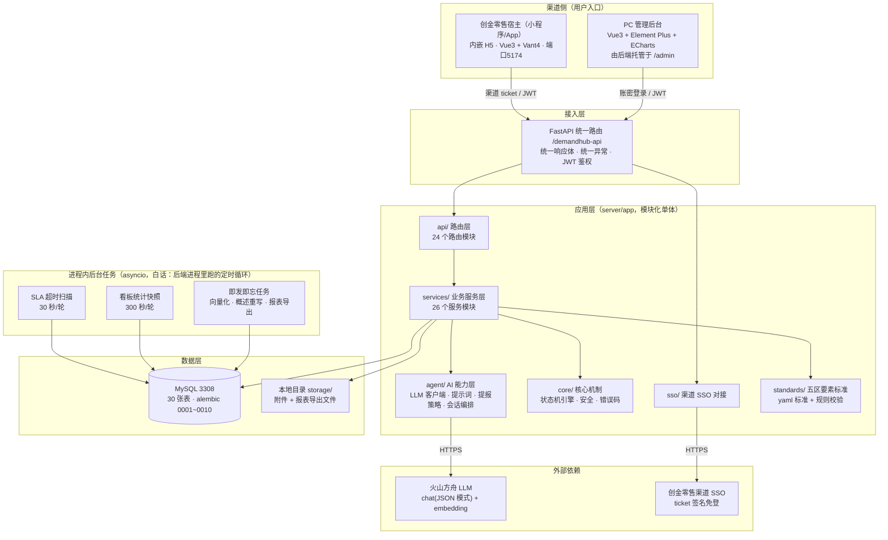
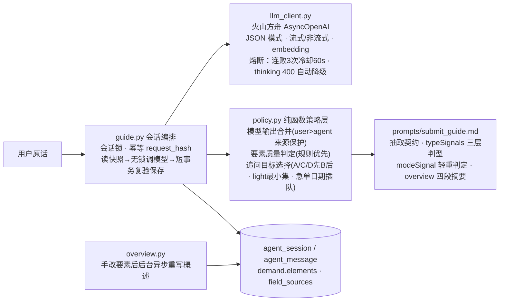

# DemandHub 系统架构文档 V1.0

| 项目 | 说明 |
|---|---|
| 版本 | V1.0（对应代码基线：alembic 迁移 0010，P0~P5 全部落地） |
| 日期 | 2026-10-14 |
| 适用范围 | Python 栈主线（server/ + frontend/h5 + frontend/admin）；Java 栈已冻结，仅作蓝本与回归参照，不在本文架构范围内 |
| 读者 | 产品、研发、测试、运维及后续接手人员 |

> 白话约定：文中首次出现的技术术语均以「（白话：…）」加注，便于非技术读者理解。

---

## 1. 架构总览

### 1.1 一句话概括

DemandHub V1.0 是一套 **Python 模块化单体（白话：一个进程内按目录严格分层的后端程序，不是拆成多个独立服务）**，对外提供统一 REST API，承载两个前端（移动 H5 + PC 管理后台），AI 能力以「AI 能力层」内嵌于单体内，数据全部落在单一 MySQL 库（30 张表），**不依赖 Redis / RocketMQ / MinIO 等任何中间件**。

### 1.2 总体架构图



### 1.3 部署架构图

```mermaid
flowchart LR
    subgraph 用户侧
        U1["业务用户<br/>（创金零售宿主内）"]
        U2["处理人 / 经理 / 高管 / 管理员<br/>（浏览器）"]
    end

    subgraph 运行环境["运行环境（单机 / Docker Compose）"]
        subgraph 后端容器["server（FastAPI · 端口 8000）"]
            APP["uvicorn 应用进程<br/>/demandhub-api + /admin 静态托管"]
        end
        DB[("MySQL · 端口 3308")]
        VOL["storage/ 本地卷<br/>附件 · 报表文件"]
        MOCK["契约 Mock（仅本地/联调）<br/>端口 8199"]
    end

    subgraph 外部服务
        ARK["火山方舟<br/>大模型服务"]
        CJ["创金零售<br/>SSO 服务"]
    end

    U1 -->|H5 · 5174(dev) / h5pub 发布(test)| APP
    U2 -->|http://host:8000/admin| APP
    APP --> DB
    APP --> VOL
    APP --> ARK
    APP --> CJ
    APP -.仅联调环境.-> MOCK
```

**端口总览（Python 栈）**

| 用途 | 端口 | 说明 |
|---|---|---|
| 后端 API | 8000 | 统一前缀 `/demandhub-api`；`/admin` 托管管理后台构建产物 |
| H5 开发服 | 5174 | 代理到 8000（修过 IPv6 解析问题） |
| 管理后台开发服 | 5175 | 代理到 8000 |
| 契约 Mock | 8199 | 仅本地/联调；test/prod 环境禁用 mock-sso |
| MySQL | 3308 | 与 Java 栈 3307 错开，两库严禁同库 |

---

## 2. 应用架构（后端 server/）

### 2.1 分层与目录职责

```
server/
├── app/
│   ├── main.py          # 应用装配工厂 create_app()：lifespan、异常处理、路由、静态托管
│   ├── config.py        # pydantic-settings 环境配置（全部走环境变量，不入库不落代码）
│   ├── api/             # 路由层：24 个模块，build_router() 统一挂 /demandhub-api
│   ├── services/        # 业务服务层：26 个服务模块，承载全部业务规则
│   ├── agent/           # AI 能力层：LLM 客户端、提示词、提报策略、会话编排
│   ├── core/            # 核心机制：状态机引擎、安全(JWT/BCrypt)、错误码、统一响应
│   ├── db/              # models.py（30 张表 SQLAlchemy 模型）+ session.py（异步会话）
│   ├── sso/             # 创金零售渠道 SSO：签名、票据验证客户端
│   └── standards/       # 五区要素标准：tech/matl/train 三份 yaml + 加载/校验/旧要素映射
├── alembic/versions/    # 数据库迁移 0001~0010（与 P0~P5 阶段一一对应）
├── tests/               # pytest 单测（CI 含 pytest + ruff）
└── storage/             # 本地存储：附件 + 报表导出文件（路径不外泄，走鉴权下载）
```

**调用方向约束**：`api → services → (agent / core / standards / db)`。禁止反向依赖，禁止 api 层直接写业务规则。

### 2.2 路由层（api/，24 个模块）

| 域 | 模块 | 主要能力 |
|---|---|---|
| 基础 | health / auth | 健康检查；渠道 SSO 登录、账密登录、refresh 旋转、改密、me |
| 需求主链路 | demand / triage / solution / comment / effort / relation | 需求 CRUD 与流转、受理分派、方案版本与评审、评论、工时、需求关系 |
| AI | agent / assist | 提报启发对话（含 SSE 流式）、处理辅助草稿、相似需求召回 |
| 标准 | standards | 五区要素标准查询（按类型） |
| 触达与度量 | notification / dashboard / report | 站内信、经营/组织看板、异步报表导出 |
| 系统管理 | admin / admin_users / admin_grants / admin_statemachine / admin_notify_templates / admin_dicts / admin_types / admin_sla / admin_channels / admin_orgs | 全部 `require_admin` 或角色工厂门控 |

### 2.3 业务服务层（services/，26 个模块）

按域归组：

- **需求域**：demand_service（创建/幂等/五区要素落库/编号）、demand_no（按类型按日流水，并发安全无断号）、flow_service（**所有流转动作唯一入口，全部经状态机引擎**）、attachment_service（白名单+魔数校验+本地存储）
- **协同域**：triage_service（受理队列/分派/领取，行锁防并发）、solution_service、comment_service、effort_service、relation_service
- **账户域**：auth_service（账密/锁定/refresh 旋转）、user_service（SSO 用户 upsert）、role_service（有效角色 = 静态 role ∪ 授权 grant 并集）
- **触达度量域**：notification_service（事件→站内信，模板渲染/偏好/接收人解析）、sla_service（黄红档扫描+7 天去重）、stat_service（实时 SQL+当日快照）、report_service（异步导出任务）
- **AI 域**：assist_service（调研问题/方案初稿草稿区）、rag_service（DONE 需求向量化+余弦相似召回）
- **配置域**：statemachine_service / sla_admin_service / dict_service / type_service / channel_service / org_service
- **导出**：export.py（markdown 导出）

### 2.4 AI 能力层（agent/）



设计要点：

- **LLM Key 只走环境变量**，不入库、不进代码仓库。
- **chat 一律 JSON 模式**（白话：强制模型返回结构化 JSON，程序可稳定解析，不靠猜文本）。
- **模型输出只是"建议"**：合并策略保证用户手改值永远覆盖 AI 值（user > agent），数字类要素必须能从原话溯源，防模型编造。
- **提示词版本化**：yaml 标准与提示词按 sha256 快照入 `prompt_version` 表，每次抽取可追溯到当时用的标准版本。

### 2.5 核心机制（core/）

#### 状态机引擎（core/statemachine/engine.py）

- 规则**落库** `state_machine_config` 表 + 进程内缓存，支持 **热重载**（白话：改规则不用重启程序，调 `/reload` 即生效）；数据库无规则时以代码内置 DEFAULT_RULES 兜底。
- 主状态 11 个：`DRAFT / SUBMITTED / NEED_INFO / TRIAGE / ANALYZING / SOLUTION_REVIEW / CONFIRMED / IN_PROGRESS / ACCEPTANCE / DONE / CLOSED`；`ON_HOLD` 不是主状态，是「挂起标签」——记下挂起前主状态，恢复时回到原状态。
- **硬约束**：任何代码禁止绕过引擎直接 UPDATE demand.status；每次流转在同一事务内写 `demand_transition_log`（留痕）并触发通知钩子。
- 角色门内置于规则：每条规则声明允许角色（如 ACCEPT=MANAGER、CLAIM=HANDLER、CHANGE_TYPE=EXECUTIVE），ADMIN 直通。

#### 安全（core/security.py + deps.py）

- 双凭证体系：H5 渠道用户走 SSO ticket 换 JWT；管理后台走账密（BCrypt）+ access token(8h) + refresh token(7d，**旋转**：白话——每次用旧 refresh 换新的一对，旧的立即作废）。
- 登录失败 5 次锁 15 分钟；首登强制改密；改密/重置/禁用均吊销全部 refresh token。
- 鉴权三档：Bearer 基础鉴权 → `RequireRole(*roles)` 角色工厂 → `require_admin`（role=ADMIN 或企微白名单，过渡兼容）。

### 2.6 五区要素标准（standards/）

需求描述的结构化标准，是本系统区别于普通工单的核心资产：

- 三份 yaml：`tech.yaml`（科技，17 要素）、`matl.yaml`（物料）、`train.yaml`（培训）。
- 要素按区分组：**A 基本信息 / B 业务区（仅业务需求激活）/ C 用户故事区 / D 验收与实现区**，另有 D9 建议方案（选填，永不追问、不进门槛）。
- 每个要素声明：key/zone/label/是否必填/选项/校验规则/三层追问话术（ask_missing/ask_l1/ask_l2）/话术锚点（ask_anchor，白话：追问时引用已填的关联要素，让用户知道 AI 在问哪一项）。
- **双口径**：常规 standard（12 项必填）与轻量 light（微需求快速通道，4 项最小集），存 `demand.ext.mode`，用户可改判，AI 也可随对话翻转升级。
- 启动时加载并做硬格式校验（rules.py），旧六要素与五区双向映射（migration_map.py）保证历史数据可读。

---

## 3. 前端架构

### 3.1 双端并存

| | H5 提报端 | PC 管理后台 |
|---|---|---|
| 目录 | frontend/h5 | frontend/admin |
| 技术栈 | Vue 3.5 + TS + Vite 5 + **Vant 4** + Pinia + axios（SSE 流式） | Vue 3.5 + TS + Vite + **Element Plus + ECharts 6** + Pinia + axios |
| 路由 | hash 模式，5 页 | hash 模式，约 15 页，meta.roles 守卫 |
| 用户 | 业务提报人（渠道免登） | ADMIN / EXECUTIVE / MANAGER / HANDLER |
| 交付 | dev 5174；test/prod 经 h5pub 发布嵌入创金零售 | 构建产物由 FastAPI 托管于 `/admin` |

### 3.2 H5 关键设计

- **chat-first 提报**：表单要素卡（FormSnapshotCard）嵌在聊天流中，AI 边聊边拆解，默认折叠只露进度与归类标签；字段三态胶囊（已填绿对勾/必填未填琥珀待补充/选填灰铅笔）。
- **宽度分级断点**：手机 <520px 全宽；平板 520~1023 壳 640px；桌面 ≥1024 壳 720px，统一由 `:root --shell-width` 变量承载，固定定位组件一律跟随变量。
- **标题栏交由宿主**：不自渲染导航栏，标题取 document.title 由创金零售小程序原生承载。

### 3.3 管理后台关键设计

- 菜单按角色显隐；路由守卫处理未登录→/login、首登强制改密→/change-password、越权→/。
- axios 拦截器统一解响应体、401 自动 refresh 重放、失败回登录页。
- 需求详情页 = 状态机动作按钮（按当前状态动态出）+ 信息卡区块 + 六 Tab（方案/AI 辅助/沟通/工时/关联/进度）。

---

## 4. 数据架构

### 4.1 表分组（30 张）

| 组 | 表 | 说明 |
|---|---|---|
| 用户与凭证 | dh_user、refresh_token、demand_role_grant | 渠道用户（账密+角色）、刷新令牌、角色授权 |
| 需求主数据 | demand、demand_no_seq、demand_change_log、demand_attachment、demand_relation | 主表含五区 elements(JSON)/ext(JSON)/field_sources；编号序列表保证并发无断号 |
| 流转协作 | demand_transition_log、assignment、solution、review、comment、effort_log | 流转留痕（硬约束必写）、分派、方案版本与评审、评论、工时 |
| AI | agent_session、agent_message、agent_draft、rag_vector、prompt_version | 会话/消息/草稿/向量/标准快照 |
| 状态机与 SLA | state_machine_config、sla_config | 规则落库可热载；按类型+状态设黄红档 |
| 通知 | notification、notification_template、notification_preference、notify_dedupe | 站内信、模板变量渲染、偏好、7 天去重 |
| 统计报表 | demand_stat_daily、report_export_task | 当日快照（5 分钟重算）、异步导出任务 |
| 系统配置 | sys_dict、demand_type、demand_channel、demand_org、channel_dept_unmapped | 字典、类型注册、渠道登记启停、组织树（物化路径）、渠道部门未映射 |

### 4.2 关键数据设计

- **demand.elements / ext 用 JSON 列**（白话：一类需求一套字段，字段演进不用天天改表结构；yaml 标准才是字段定义的真相，表只是承载）。
- **快照思想**：需求挂 `standard_version_id`（prompt_version 表），历史需求永远按当时标准展示，新标准不影响旧数据。
- **编号**：`demand_no_seq` 按「类型+日期」行锁发号，格式 `TECH/MATL/TRAIN-YYYYMMDD-NNN`，并发安全无断号。
- **迁移即阶段史**：alembic 0001(MVP 六表) → 0002(五区要素) → 0004(附件) → 0005(账密角色) → 0006(P2 流转) → 0007(P3 AI 辅助+RAG) → 0008(P4 通知统计) → 0009(角色四值重映射) → 0010(P5 系统配置)。

---

## 5. 安全与合规设计

| 主题 | 现状 |
|---|---|
| 认证 | H5：渠道 ticket 免登（60 秒有效，test/prod 禁用 mock-sso 与 dev-login）；管理后台：账密+双 token |
| 授权 | 四角色 ADMIN/EXECUTIVE/MANAGER/HANDLER；管理接口 `require_admin`；有效角色 = 静态 role ∪ grant 授权 |
| 数据脱敏 | 用户管理接口不返回 password_hash，手机/邮箱脱敏；附件路径不外泄，走鉴权下载 |
| 密钥管理 | LLM Key、管理员初始密码等一律环境变量注入，不入库不进仓库 |
| 审计 | 流转日志、要素变更留痕（change_log）、通知去重记录、导出任务记录 |
| 密码 | BCrypt 存储，永不明文、永不入日志 |

---

## 6. 关键技术决策（ADR 摘要）

| 决策 | 结论 | 理由 |
|---|---|---|
| 单体 vs 微服务 | Python **模块化单体**整体替代 Java 微服务 | 现阶段团队规模与业务量下，单体的交付效率、事务一致性、运维简单性全面占优；微服务拆分点（域边界）已在目录层保留 |
| 中间件 | **不引** Redis/RocketMQ/MinIO | 用 DB 表（通知信箱、去重、任务表）+ 进程内 asyncio 任务 + 本地目录替代，降低运维门槛；量级上来后可按 §7 路径回补 |
| 状态机 | 规则落库 + 热重载 + 唯一流转入口 | 业务规则可由 ADMIN 在线调整，且杜绝"绕过流程直接改状态"的腐败路径 |
| AI 输出 | JSON 模式 + 规则兜底 + 用户值优先 | 模型不确定性强，确定性交给代码与规则，模型只做"建议" |
| 需求字段 | yaml 标准 + JSON 列 + 版本快照 | 字段随业务演进频繁，避免高频改表；历史数据按当时标准可解释 |
| Java 历史数据 | 不迁移，旧库只读归档 | 两套编号体系与模型差异大，迁移成本高于收益 |

---

## 7. 架构演进方向

### 7.1 近期（P6 收尾，当前进行中）

- **Java 栈下线归档**：e2e 双模式（none/mock）全绿后，Java 微服务与旧库只读归档，仓库清理 backend/ 与旧部署脚本（见 docs/P6_上线运维清单_v1.0.md、P6_验收场景核对矩阵_v1.0.md）。
- 正式上线前将 H5 渠道登录从 `trusted_parameters` 联调模式改回 **ticket 模式**（当前 test 环境为联调便利临时放开）。

### 7.2 中期（V1.x，按业务量触发）

1. **数据范围三维过滤**：角色四值已就位（0009），但 MANAGER/EXECUTIVE 目前仍是全量数据可见。后续按「组织物化路径 × 类型集合」落地行级数据权限（demand 表 assignee_org_id/submitter_org_id 两列已预留，只建未用）。
2. **通知外溢通道**：当前只有站内信。预留模板引擎与接收人解析能力，可平滑接企微应用消息/邮件，notification 表加通道列即可，不动事件骨架。
3. **附件与报表对象存储化**：本地目录 → MinIO/S3 的切换点已隔离在 attachment_service 与 report_service 内部，换实现不改接口。
4. **RAG 升级**：当前 rag_vector 本地余弦召回；语料增长后可换 pgvector/独立向量库，召回入口 `GET /rag/similar` 契约不变。
5. **后台任务外置**：SLA 扫描与统计快照目前是进程内 asyncio 循环，多实例部署时需收口为单实例或迁入独立调度器（如 APScheduler/cron worker），任务逻辑已集中在 service 层，搬迁成本低。
6. **企微/微信选文件**：H5 附件已留按钮位与桥接代码，实际生效依赖创金零售宿主开放 wx.chooseMessageFile 等能力。

### 7.3 远期（V2.0 方向，预案不立项目）

- **读写分离与缓存**：看板/列表是读多写少热点，量级到万级需求/日后优先补只读副本 + 查询缓存（届时再评 Redis）。
- **领域事件外化**：通知钩子目前是进程内函数调用，若未来拆分服务，demand_transition_log 即天然事件源，可平滑演进为消息驱动。
- **微服务拆分预案**：若必须拆，第一刀沿「AI 能力层（agent/ + rag/assist）」与「需求主链路」切分——前者有无状态、可独立扩缩、对 LLM 依赖强三重特征，拆分代价最小。
- **多租户/多渠道**：demand_channel 已管渠道登记启停，组织树已物化，向多业务线开放时以渠道+组织为租户隔离面。

---

## 8. 架构质量属性自评

| 属性 | 现状 | 保障手段 |
|---|---|---|
| 一致性 | 高 | 单体事务；流转/编号/留痕同事务；行锁防并发领取与发号 |
| 可用性 | 中 | 单进程单库；LLM 有熔断降级（AI 不可用不阻塞非 AI 链路） |
| 可维护性 | 高 | 分层清晰、24+26 模块边界明确；规则/标准/模板配置化 |
| 可测试性 | 高 | pytest+ruff / vitest+tsc / e2e 双模式纳入 CI；policy 层纯函数 |
| 可演进性 | 高 | 域边界目录化、配置落库、快照隔离、降级点均可回补 |
| 安全性 | 中高 | 双凭证、角色门、脱敏、密钥环境变量化；数据范围细化为已知的待办项 |
